<picture>
  <source
    media="(prefers-color-scheme: dark)"
    srcset="assets/icons/dark@1x.png 1x, assets/icons/dark@2x.png 2x">
  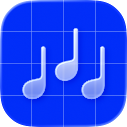
</picture>

# Mezzo

Mezzo is a native music player app for self-hosted music servers.

Currently available for iPhone, with support for Navidrome and other Subsonic-compatible servers.

> [!TIP]
> The app is in active development, and is currently available to test through TestFlight.
>
> 🔷 [**Join TestFlight to test Mezzo!**](https://testflight.apple.com/join/Ub8M3z6A)

## Videos

<table>
  <tr>
    <td align="center">
      <a href="https://github.com/user-attachments/assets/4cee7cdf-7937-4129-a8e3-ec6c3f2c21d8">
        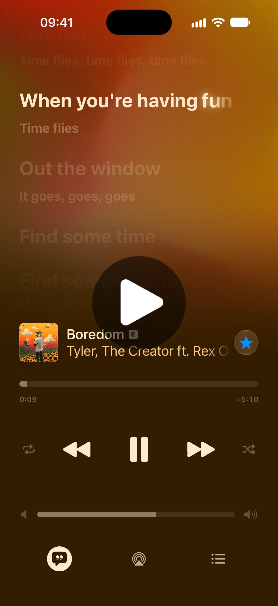
      </a>
       
      Synced Lyrics
    </td>
    <td align="center">
      <a href="https://github.com/user-attachments/assets/cd7485cc-7e95-412a-a88c-12010e471122">
        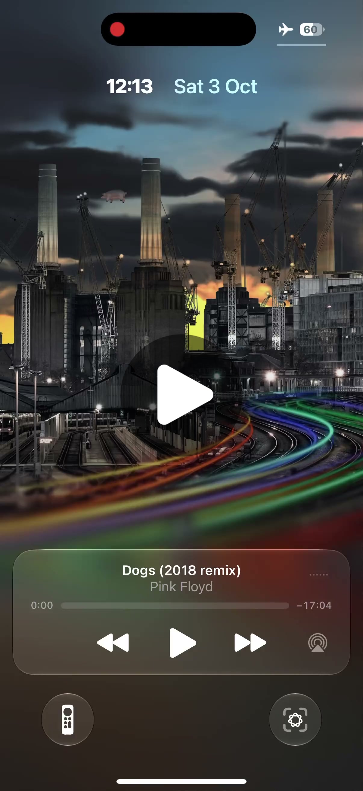
      </a>
       
      Animated Artworks
    </td>
    <td align="center">
      <a href="https://github.com/user-attachments/assets/80af29a7-f69a-45f3-ab2a-33e170abc903">
        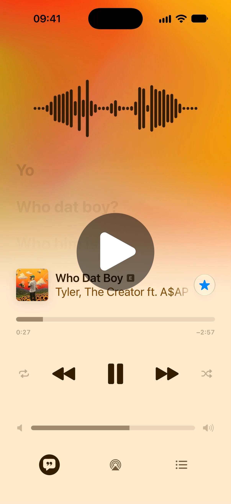
      </a>
       
      Visualizer
    </td>
  </tr>
  <tr>
    <td align="center">
      <a href="https://github.com/user-attachments/assets/195926c6-b056-4780-8993-fb5cd2f888ad">
        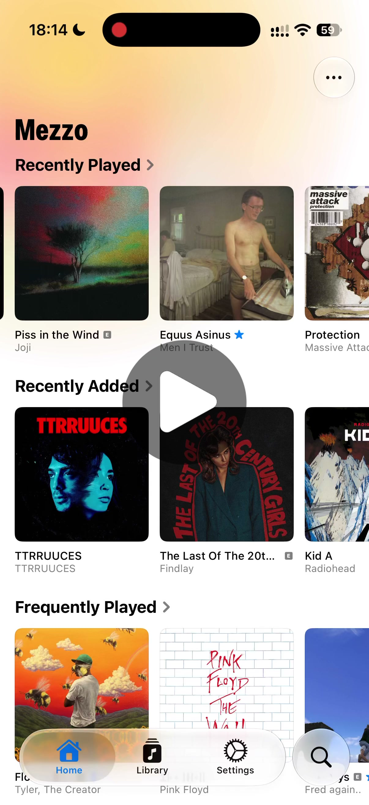
      </a>
       
      Offline Mode
    </td>
  </tr>
</table>

## Screenshots

### Dark Mode

<table>
  <tr>
    <td align="center">
      <a href="https://raw.githubusercontent.com/HazemAM/mezzo-tracker/main/assets/screenshots/dark/album-flower-boy.png">
        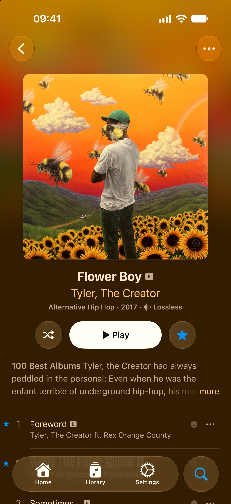
      </a>
    </td>
    <td align="center">
      <a href="https://raw.githubusercontent.com/HazemAM/mezzo-tracker/main/assets/screenshots/dark/artist-mac-miller.png">
        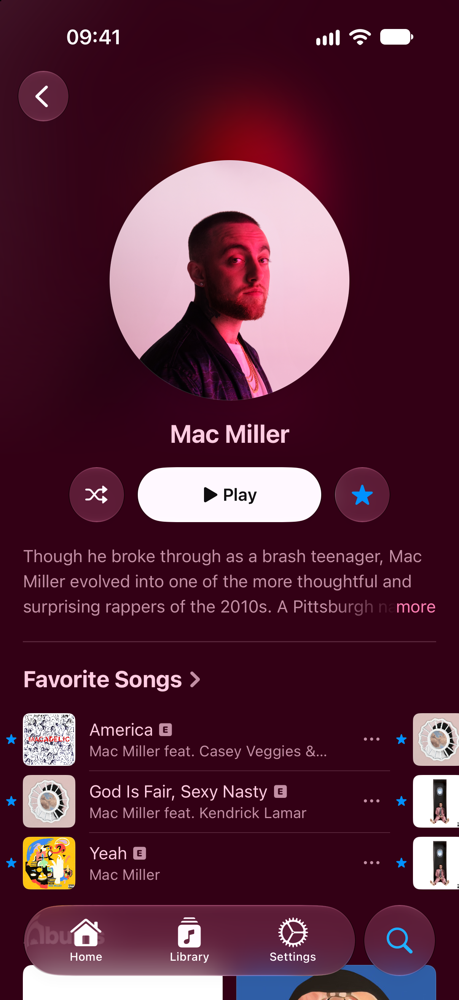
      </a>
    </td>
    <td align="center">
      <a href="https://raw.githubusercontent.com/HazemAM/mezzo-tracker/main/assets/screenshots/dark/player-enough.png">
        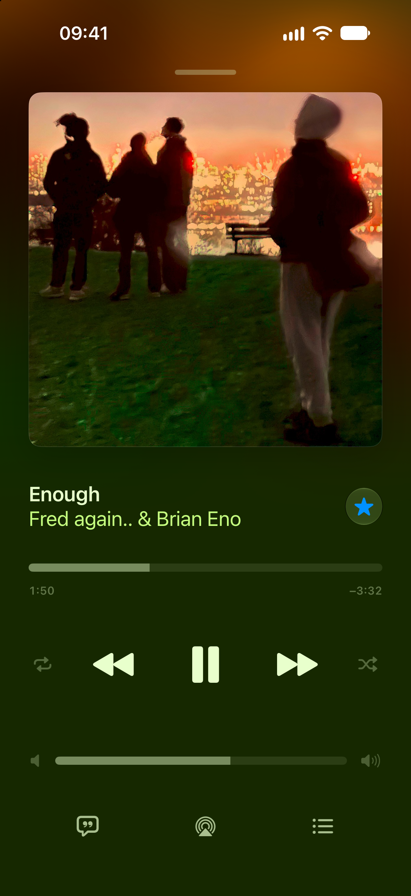
      </a>
    </td>
    <td align="center">
      <a href="https://raw.githubusercontent.com/HazemAM/mezzo-tracker/main/assets/screenshots/dark/search-aw.png">
        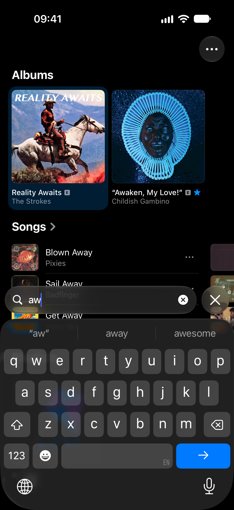
      </a>
    </td>
  </tr>
</table>

### Light Mode

<table>
  <tr>
    <td align="center">
      <a href="https://raw.githubusercontent.com/HazemAM/mezzo-tracker/main/assets/screenshots/light/album-flower-boy.png">
        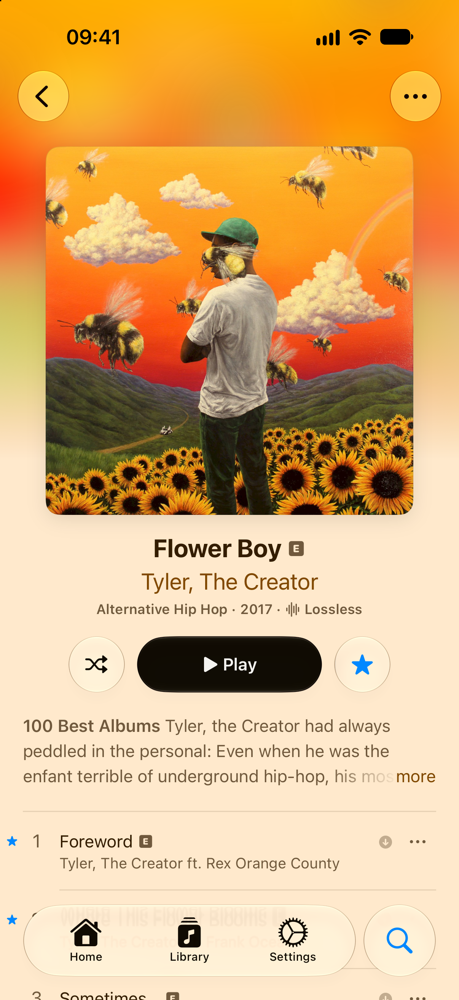
      </a>
    </td>
    <td align="center">
      <a href="https://raw.githubusercontent.com/HazemAM/mezzo-tracker/main/assets/screenshots/light/artist-mac-miller.png">
        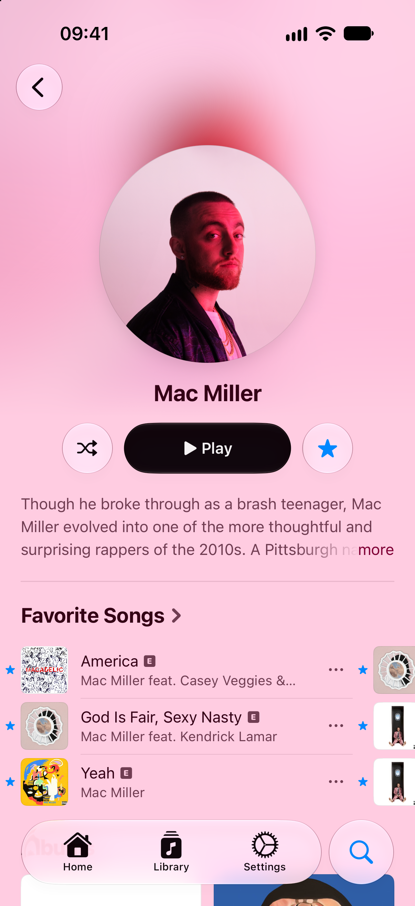
      </a>
    </td>
    <td align="center">
      <a href="https://raw.githubusercontent.com/HazemAM/mezzo-tracker/main/assets/screenshots/light/player-enough.png">
        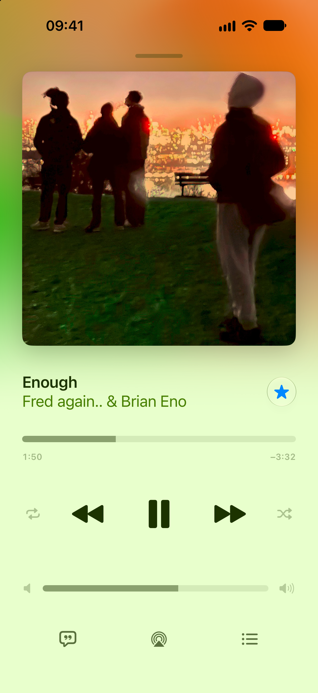
      </a>
    </td>
    <td align="center">
      <a href="https://raw.githubusercontent.com/HazemAM/mezzo-tracker/main/assets/screenshots/light/search-aw.png">
        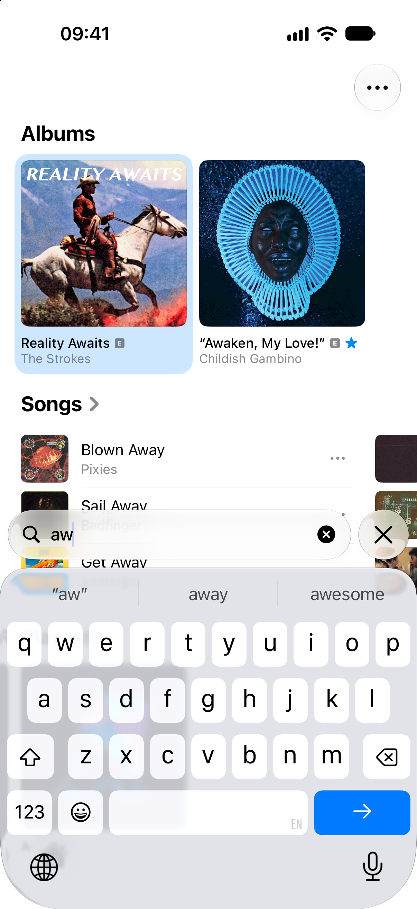
      </a>
    </td>
  </tr>
</table>

## Current features

- **Lyrics: Full karaoke lyrics support**
  - Karaoke lyrics with syllable-level highlighting & visual effects
  - External sources support for songs without lyrics on your server
  - Interactive lyrics UI
  - Swipe down on the seek bar to jump between lyric lines
  - Lyrics are downloaded with their songs and remain available in Offline Mode, including karaoke lyrics when available
- **Animated artworks**
  - Animated covers for supported albums on album pages, in the player, and on the Lock Screen
  - No special server setup is needed, animated artworks don’t need to be stored on your server
  - To see animated artworks on the Lock Screen, tap the artwork to expand it
- **Visualizer**
  - Instrumental breaks appear as a live visualizer in synced lyrics
  - The visualizer is very accurate and responsive, allowing you to see hidden details in songs
  - The visualizer also appears when no lyrics are available for a song
  - The currently playing song also shows a live visualizer across the app
- **Themed pages**
  - Artwork-inspired themed pages for albums, playlists, artists and in the player screen
  - Different looks for Light and Dark modes
- **Audio quality**
  - Lossless and original-quality streaming
  - Separate quality and bitrate settings for Wi-Fi, mobile data, and downloads
  - Smart Transcoding setting chooses the best quality based on factors like available audio cache, your network, your desired bitrate, etc.
- **ReplayGain**
  - More consistent playback volume, with album adjustments for album playback and track adjustments for playlists and other contexts
  - Uses ReplayGain metadata from your music server
- **Similar music**
  - Autoplay: Keep playing similar music after your queue ends
  - Song Radio: Start a radio station from any song
  - Support for sonic similarity plugins, including [AudioMuse-AI](https://github.com/NeptuneHub/AudioMuse-AI-NV-plugin), to get better matching music similarity
- **Home**
  - Personalized shelves for recently played, recently added, frequently played, and random music
  - Quick access to favorite albums, songs, and artists
- **Search**
  - Universal search across your entire library, with a top result to jump to
  - Search only in parts of your library, or search directly in a playlist or album
  - Search is fully supported for downloaded songs, albums, artists, playlists, and genres in Offline Mode
  - Supports matching for stylized names, alternate names, and multi-language titles
- **Downloads**
  - Download individual songs, albums, and playlists, and follow their progress in place
  - Downloads are periodically refreshed, updating automatically on Wi-Fi
  - Choose a separate download quality in Settings
- **Offline Mode**
  - See only your downloads, with Offline Mode activating automatically when you’re offline
  - Turn it on manually from Home, Library, or Search when you want to minimize data usage
  - Badges in Home, Library, Search, and artist pages let you know when it’s active
  - Offline playback
    - Lyrics are downloaded with their songs and remain available in Offline Mode, including karaoke lyrics when available
    - Albums remain fully browsable with their editorial notes and complete track lists, while unavailable songs appear dimmed
    - Every artist credited on a downloaded song or album remains browsable, including their biographies, Favorite Songs, Appears On and Similar Artists sections
  - Offline Library
    - Browse and locally search downloaded songs, albums, artists, playlists, and genres
    - Filter your downloads by favorites, sort the results, and shuffle across your full downloaded collection
- **Siri & Shortcuts**
  - Lock Screen suggestions for recent listening sessions, including Favorites, Downloads, and Song Radio
  - Ask Siri to play songs, albums, playlists, artists, and genres, shuffle your library, or start Song Radio
  - “Shuffle Favorites” shortcut available through Siri, Shortcuts, and Spotlight
- **Artist pages**
  - Albums organized by release type
  - Appears On section for albums where the artist is featured
  - Similar Artists section
- **Queue system**
  - Swipe on a song anywhere to add it to the queue, swipe in the queue to remove it
  - Reorder songs in the queue
- **Playlist management**
  - Add songs to one or multiple playlists, with duplicate song detection
  - Remove songs directly by swiping on them
- **Album editorial notes**
    - Available through compatible server plugins, including [Navidrome’s official Apple Music plugin](https://github.com/navidrome/apple-music-plugin)
    - Supports text formatting (e.g. bold, italic)
- **Library browsing**
  - Browse your library by albums, artists, songs, playlists, and genres, with multiple sort options
  - Filter by favorites with search and shuffle support
- **Library pins**
  - Pin albums, artists, and playlists to your Library
  - Reorder pinned items by dragging and dropping
- **Storage management**
  - View breakdown of storage usage and clear cache from Settings
  - Browse downloaded music or remove all downloads
- **Dynamic Type**
  - Text and layouts adapt to your preferred text size in iOS
- **Scrobbling to server**
- **AirPlay 2 support**
- **Gapless playback**
- **Shuffle & repeat modes**
- **Dark & Light mode support across the app**

## Planned features

- [ ] Creating new playlists
- [ ] CarPlay support
- [ ] Spotlight integration
- [ ] Recommendations

- [x] Library pins
- [x] Artwork themes
- [x] Storage management
- [x] Visualizer
- [x] ReplayGain support
- [x] Siri support
- [x] Animated artworks
- [x] Downloading & Offline Mode
- [x] Filtering & sorting in library
- [x] Playlist management
- [x] Shuffle & repeat modes
- [x] Search

> [!TIP]
> Want to see what’s being added in every update? Visit [**Releases**](https://github.com/HazemAM/mezzo-tracker/releases).

## Long-term roadmap

- macOS app
- tvOS app
- Support for more music servers

## Issues & feedback

Found a bug, or have feedback or a feature request? Please [open an issue](https://github.com/HazemAM/mezzo-tracker/issues/new/choose).
